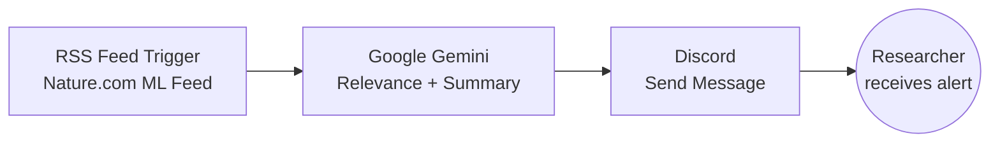
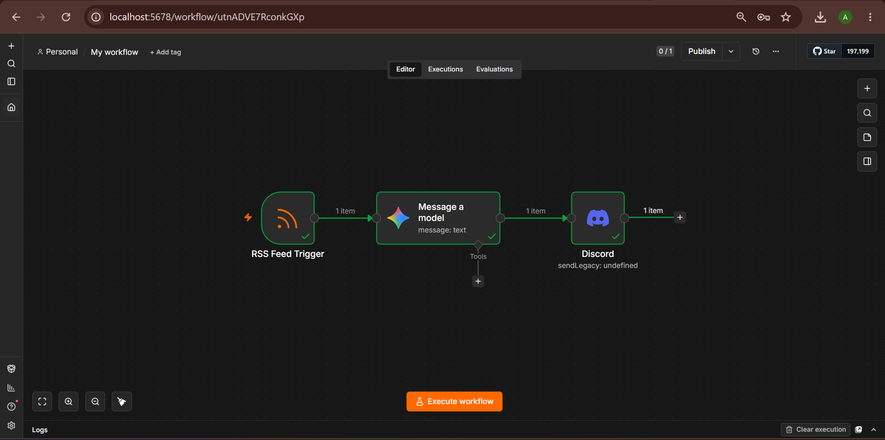
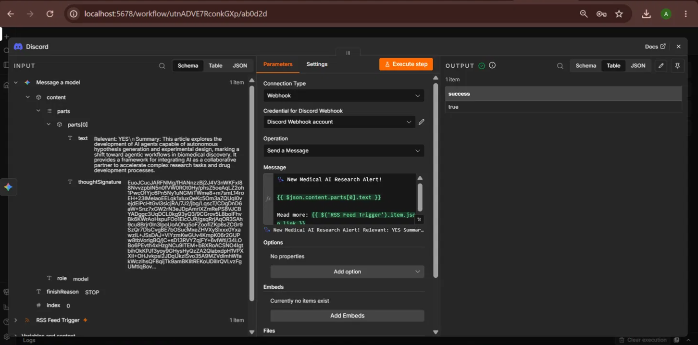
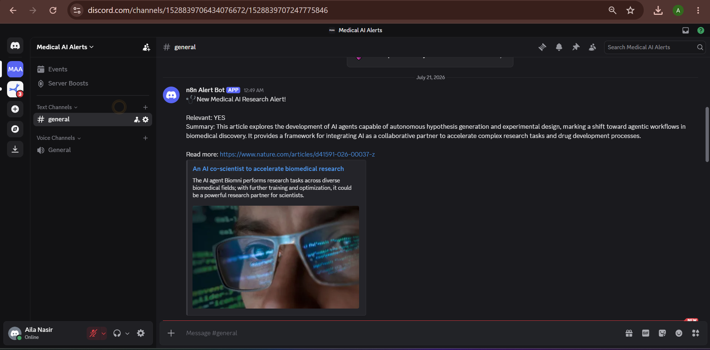

# 🩺 Medical AI Research Alert Agent


An autonomous, AI-powered n8n workflow that monitors published research, evaluates relevance using Google Gemini, and delivers filtered summaries directly to a Discord channel — designed to automate research literature triage for healthcare AI work.

---

## Table of Contents

- [Overview](#overview)
- [Problem Statement](#problem-statement)
- [System Architecture](#system-architecture)
- [Node Breakdown](#node-breakdown)
- [Benefits](#benefits)
- [Tech Stack](#tech-stack)
- [How It Runs](#how-it-runs)
- [Screenshots](#screenshots)
- [Workflow JSON](#workflow-json)
- [Future Improvements](#future-improvements)
- [Author](#author)

---

## Overview

Research in healthcare AI moves fast, and manually tracking every relevant publication across feeds is time-consuming and error-prone. This project implements an agentic pipeline that continuously watches a research feed, uses a large language model to judge relevance against a defined research focus, and only surfaces the papers that matter — with zero manual screening.

This is a working, tested automation (not just a canvas design) — every run produces a verifiable execution log and a delivered Discord message.

## Problem Statement

As an AI/ML researcher focused on **healthcare AI**, **agentic workflows**, and **model evaluation**, staying current with new research traditionally requires:

| Manual Process | Time Cost | Pain Point |
|---|---|---|
| Checking multiple RSS/research feeds daily | ~15–20 min/day | Repetitive, easy to miss updates |
| Reading full abstracts to judge relevance | ~5 min/article | Most articles are not relevant |
| Manually compiling notable papers | ~10 min/week | No structured record kept |

This agent removes all three friction points by automating detection, judgment, and delivery in a single pipeline.

## System Architecture



## Node Breakdown

| # | Node | Type | Function |
|---|---|---|---|
| 1 | RSS Feed Trigger | Trigger | Polls Nature.com's Machine Learning feed for newly published articles |
| 2 | Message a Model (Google Gemini) | AI | Reads the article's title and content snippet; outputs a YES/NO relevance decision plus a two-line summary |
| 3 | Discord — Send a Message | Action | Posts the AI-generated summary and article link to a Discord channel via webhook |

## Benefits

| Benefit | Description |
|---|---|
| ⏱️ Time savings | Eliminates manual feed-checking and abstract screening |
| 🎯 Signal over noise | Only relevant papers reach the researcher, filtered by an LLM rather than keyword matching |
| 🤖 Zero-maintenance monitoring | Runs on a schedule with no manual intervention once deployed |
| 🧩 Extensible design | Each node (feed source, AI model, delivery channel) can be swapped independently |
| 📄 Verifiable output | Every execution produces a logged, reproducible result |

## Tech Stack

| Component | Tool Used |
|---|---|
| Workflow Orchestration | [n8n](https://n8n.io) (self-hosted) |
| AI Reasoning | Google Gemini API |
| Alert Delivery | Discord Webhooks |
| Data Source | RSS/Atom feed parsing |
| Runtime | Node.js |

## How It Runs

1. n8n polls the configured RSS feed on a schedule
2. When a new article is detected, its title and content snippet are passed to Gemini
3. Gemini evaluates the article against the research focus areas and returns a structured response:
   ```
   Relevant: YES/NO
   Summary: <two-line summary>
   ```
4. If relevant, the workflow formats and sends the summary + article link to Discord via webhook
5. The Discord message renders an automatic link preview of the source article

## Screenshots

### Workflow Canvas

*All three nodes connected and successfully executed (green checkmarks).*

### Successful Execution Log

*n8n execution output confirming `success: true`.*

### Live Discord Alert

*The actual delivered alert, including AI-generated summary and auto-rendered article preview.*

## Workflow JSON

The full exported workflow is available in [`workflow.json`](./workflow.json) — importable directly into any n8n instance via **Settings → Import from File**.

## Future Improvements

| Priority | Improvement |
|---|---|
| High | Add multiple RSS sources (PubMed, arXiv cs.AI) for broader coverage |
| High | Store processed article IDs to prevent duplicate alerts on restart |
| Medium | Add a weekly digest mode summarizing all relevant papers in one message |
| Medium | Deploy on a cloud instance (Railway/Render) for 24/7 monitoring |
| Low | Add a scoring system to rank papers by relevance strength, not just YES/NO |

## Author

**Aila Nasir**
AI/ML Researcher — Agentic Workflows and Model Evaluation

[LinkedIn](https://linkedin.com/in/ailanasirai) · [GitHub](https://github.com/ailanasirai) · [Kaggle](https://kaggle.com/ailanasirai)
